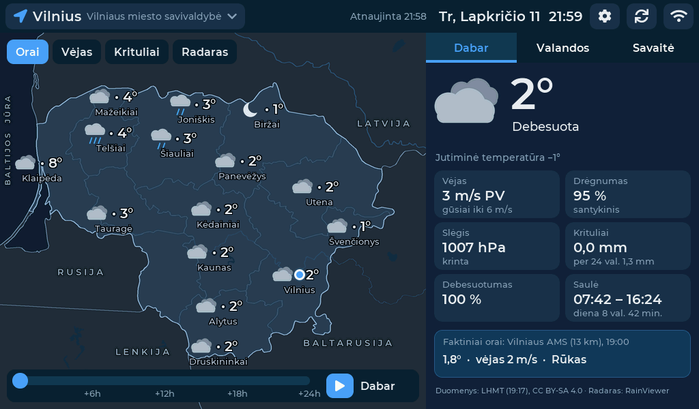
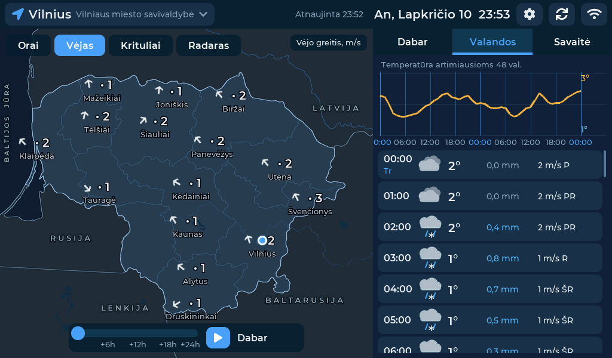
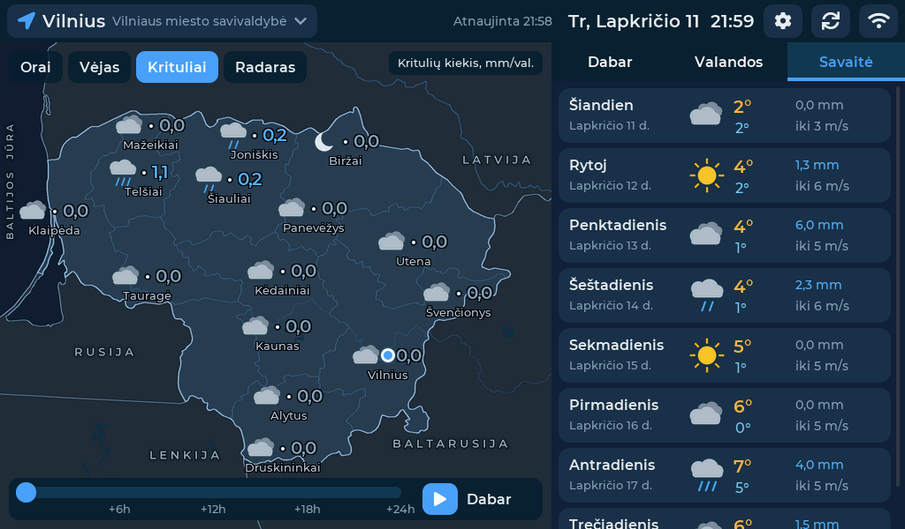
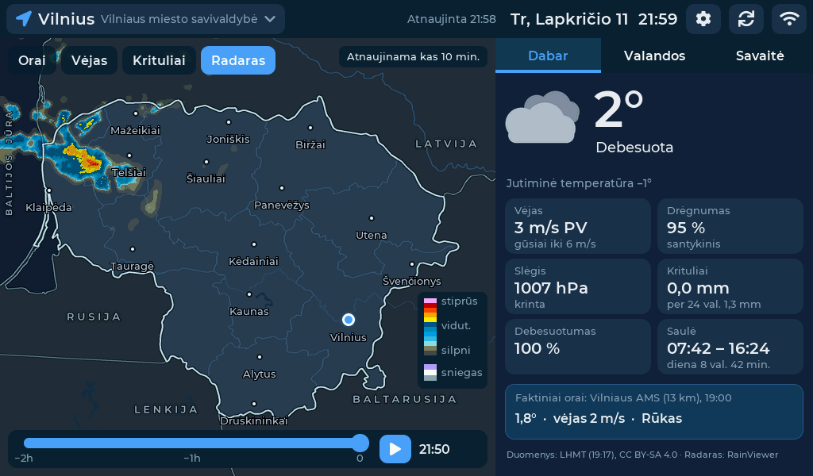
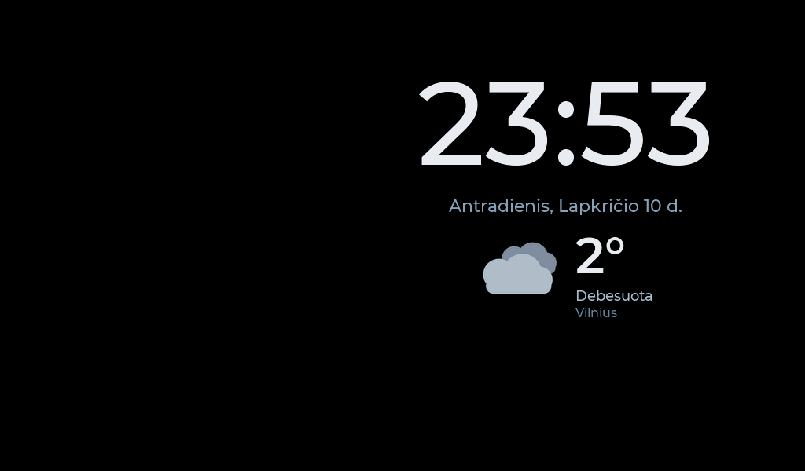

# Orų Orai – programinės įrangos atnaujinimai ir atviri duomenys

Šiame repo yra sukompiliuota „Orų Orai“ programa Waveshare ESP32-S3-Touch-LCD-7B ekraniukui (`firmware.bin`, `version.json`).
Ekraniukai ją atsisiunčia per Wi-Fi: **Nustatymai → Programinė įranga**.

## Ekrano kopijos

| | |
|---|---|
|  |  |
| Orų žemėlapis ir dabartiniai orai | Vėjo žemėlapis ir valandinė prognozė |
|  |  |
| Kritulių žemėlapis ir savaitės prognozė | Kritulių radaras (tiesiogiai ir 2 val. istorija) |
|  |  |
| Vietovės paieška (2324 LHMT vietovės) | Užsklanda |

## Orų duomenys (LHMT, CC BY-SA 4.0)

Prognozės, faktiniai stebėjimai ir vietovių bei stočių sąrašas gaunami iš
**Lietuvos hidrometeorologijos tarnybos prie Aplinkos ministerijos (LHMT)**: <https://api.meteo.lt>.

Duomenys naudojami pagal licenciją **Creative Commons Priskyrimas–Analogiškas platinimas 4.0 tarptautinė (CC BY-SA 4.0)**:
<https://creativecommons.org/licenses/by-sa/4.0/legalcode.lt>.

Duomenys yra pakeisti:
- reikšmės suapvalintos;
- parenkama artimiausia prognozės valanda;
- duomenys sugrupuoti pagal dienas;
- duomenys pavaizduoti ikonomis, grafiku ir žemėlapyje.

Ekraniuke rodomi išvestiniai orų duomenys taip pat platinami pagal CC BY-SA 4.0.

Duomenys teikiami „tokie, kokie yra“, be jokių garantijų. LHMT neatsako už duomenų tikslumą ir jų naudojimo pasekmes.
LHMT šio produkto neremia ir su juo nesusijusi.

### Programinėje įrangoje įdiegti LHMT duomenys

Programinėje įrangoje įdiegti du LHMT sąrašai, jie čia pateikti atvirai pagal **CC BY-SA 4.0**:

| Failas | Turinys | Šaltinis | Pakeitimai |
|---|---|---|---|
| [`places.csv`](places.csv) | 2324 Lietuvos vietovės: kodas, pavadinimas, savivaldybė, koordinatės | <https://api.meteo.lt/v1/places> | atrinktos Lietuvos vietovės, surikiuotos pagal pavadinimą, pridėtas paieškos raktas `search_key` (be diakritikų) |
| [`stations.csv`](stations.csv) | 52 LHMT meteorologijos stotys: kodas, pavadinimas, koordinatės | <https://api.meteo.lt/v1/stations> | konvertuota į CSV |

## Kiti duomenys

- **Kritulių radaras:** Weather data by RainViewer, <https://www.rainviewer.com>. Radaro duomenis teikia nacionalinės meteorologijos tarnybos, žr. <https://www.rainviewer.com/sources.html>.
- **Žemėlapis:** Made with Natural Earth (viešasis domenas), <https://www.naturalearthdata.com>.

## Saugumas

- **Pasirašyti atnaujinimai.** Nuo v1.2.12 `firmware.bin` pasirašomas ECDSA P-256 (SHA-256) parašu. Parašas yra paskutiniuose 512 baitų.
  Ekraniukas įdiegia tik tinkamai pasirašytą programą. Nepasirašytas ar pakeistas failas atmetamas, o įrenginys toliau veikia su esama versija.
  Viešasis raktas:
  ```
  -----BEGIN PUBLIC KEY-----
  MFkwEwYHKoZIzj0CAQYIKoZIzj0DAQcDQgAEf7N4p+rtATAGNW51qN0cNvwPQXIS
  qceJkY1Cf++Pm17dEgKdvKEOiuvehF11xfsrbzjApfDFSeHsseuwry1Iqg==
  -----END PUBLIC KEY-----
  ```
- **Šifruotas ryšys.** Visi ryšiai (api.meteo.lt, RainViewer, GitHub) naudoja HTTPS, o serverių sertifikatai tikrinami pagal Mozilla šakninių sertifikatų sąrašą.
- **Gamykliniai nustatymai.** Mygtukas **Nustatymai → Atkurti gamyklinius** ištrina Wi-Fi tinklą ir slaptažodį, vietovę bei kitus nustatymus.

## Atviro kodo komponentai

Pranešimai ir licencijos aprašyti [`NOTICE.md`](NOTICE.md). Pilni licencijų tekstai yra kataloge [`licenses/`](licenses/).
